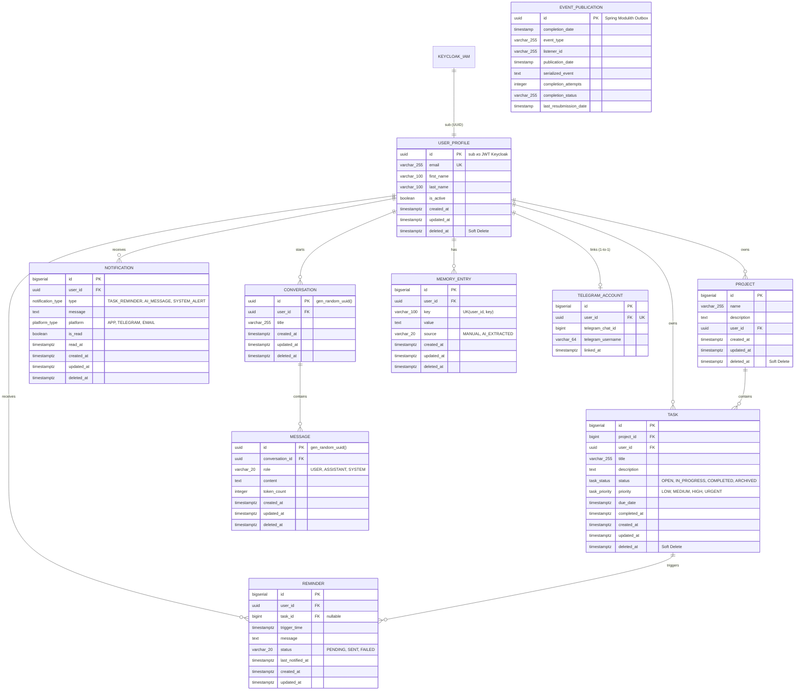

# Модель данных и ER-диаграмма базы данных Klawa (с Keycloak IDP)

Данный документ содержит полную спецификацию схемы базы данных, ER-диаграмму (Entity-Relationship) и аудит соответствия между JPA Entity (Java) и миграцией Flyway (`V0__init_tables.sql`) с учётом интеграции **Keycloak** в качестве внешнего Identity & Access Management (IAM / OIDC).

---

## 1. Архитектурные изменения после перехода на Keycloak

1. **Сервер авторизации Keycloak**:
   - Хранит учетные данные пользователей, хэши паролей (Argon2 / PBKDF2), управляет MFA/2FA.
   - Выпускает и ротирует JWT Access и Refresh токены.
   - Управляет ролями (`ROLE_USER`, `ROLE_ADMIN`), которые передаются внутри JWT токена в claim `realm_access.roles`.
2. **Таблица `refresh_token`**: **ПОЛНОСТЬЮ УДАЛЕНА** из БД Klawa. Управление сессиями и токенами теперь на стороне Keycloak.
3. **Таблица `user_profile` (ранее `_user`)**:
   - Первичный ключ `id UUID PRIMARY KEY` — совпадает с `sub` (UUID пользователя) из JWT токена Keycloak.
   - Поля `password` и `roles` удалены из базы Klawa.
   - Создаётся и наполняется локальный профиль (Just-In-Time provisioning) при первой авторизации пользователя.
4. **Внешние ключи**:
   - Во всех связанных таблицах (`project`, `task`, `reminder`, `notification`, `conversation`, `memory_entry`, `telegram_account`) колонка `user_id` переведена с `BIGINT` на `UUID REFERENCES user_profile(id) ON DELETE CASCADE`.

---

## 2. ER-диаграмма базы данных (Mermaid)

---

## 3. Перечисления (Enums)

| Enum | Значения | Где используется |
|---|---|---|
| `task_status` | `OPEN`, `IN_PROGRESS`, `COMPLETED`, `ARCHIVED` | `task.status` |
| `task_priority` | `LOW`, `MEDIUM`, `HIGH`, `URGENT` | `task.priority` |
| `notification_type`| `TASK_REMINDER`, `AI_MESSAGE`, `SYSTEM_ALERT` | `notification.type` |
| `platform_type` | `APP`, `TELEGRAM`, `EMAIL` | `notification.platform` |
| `reminder_status` | `PENDING`, `SENT`, `FAILED` | `reminder.status` |
| `message_role` | `USER`, `ASSISTANT`, `SYSTEM` | `message.role` |
| `memory_source` | `MANUAL`, `AI_EXTRACTED` | `memory_entry.source` |

*(Примечание: `user_role` удалён из Postgres, так как роли выдаются и валидируются через Keycloak)*

---

## 4. Памятка для обновления JPA Entity под новую схему

Когда будете писать код сущностей:

1. **`UserProfile.java`**:
   - `@Id private UUID id;` (без `@GeneratedValue`, так как ID присваивается Keycloak).
   - Убрать поля `password` и `roles`.
   - Имя таблицы: `@Table(name = "user_profile")`.
2. **Все внешние ключи `userId`**:
   - Во всех Entity (`Task`, `Project`, `Reminder`, `Notification`, `Conversation`, `MemoryEntry`, `TelegramAccount`):
     - `private UUID userId;` (вместо `Long userId`).
3. **Удалить Entity `RefreshToken.java`**:
   - Сущность больше не нужна.
4. **`Task.java`**:
   - Исправить имя таблицы: `@Table(name = "task")` (в единственном числе).
5. **`Project.java`**:
   - Убрать ошибочный `unique = true` с полей `userId` и `description`.
6. **`Message.java`**:
   - Исправить имя колонки: `@Column(name = "conversation_id")` (убрать опечатку `convesation_id`).
   - Тип `conversationId`: `UUID` (вместо `Long`).
   - Роль `role`: создать отдельный enum `MessageRole { USER, ASSISTANT, SYSTEM }`.
